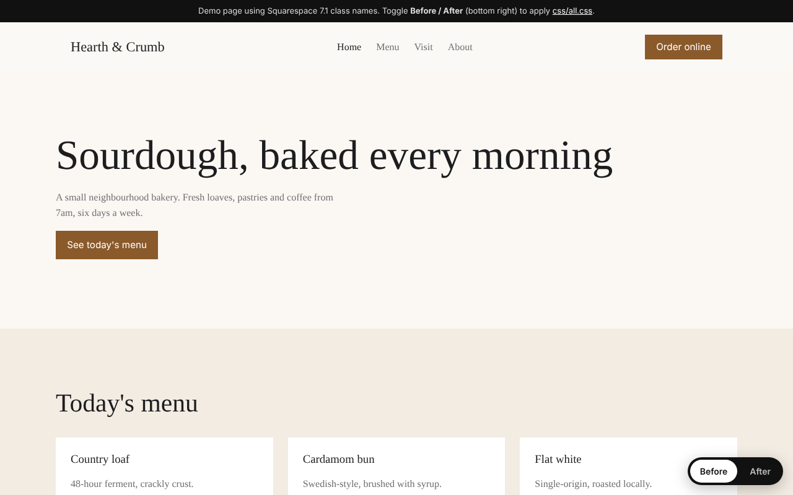
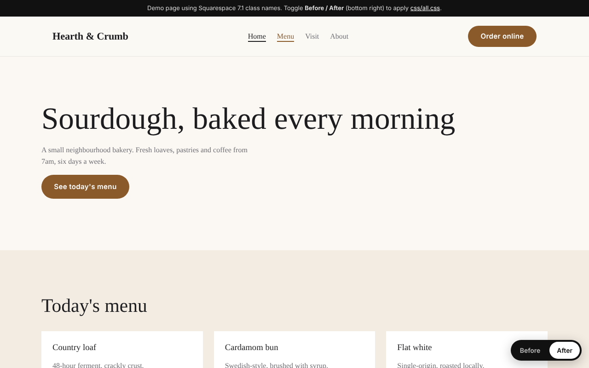
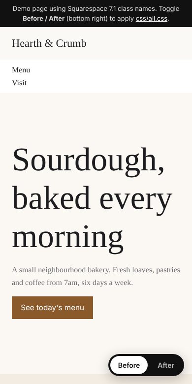
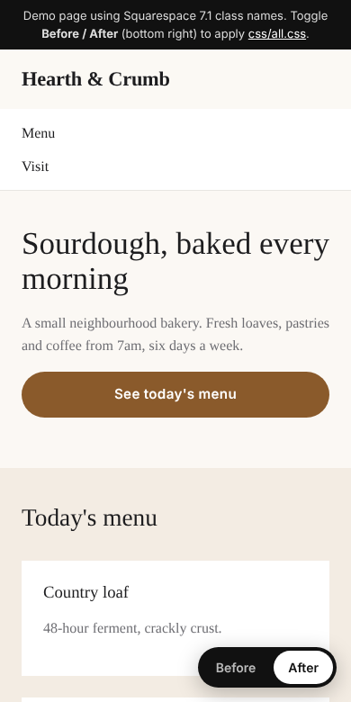

# Squarespace toolkit

Two small tools I use when fixing up Squarespace sites:

1. **`linkcheck`**: a broken-link checker. It crawls a live site and reports every 404, dead image and redirect chain, along with the page each one was found on.
2. **CSS snippets for Squarespace 7.1**: header, buttons, footer and mobile fixes. Paste them into *Website → Pages → Custom Code → Custom CSS*.

**Live demo (before / after toggle):** https://dmytro-kuz.github.io/squarespace-toolkit/demo/

| Before | After |
|---|---|
|  |  |
|  |  |

## Broken-link checker

Requires Node 20 or newer. It has no dependencies.

```bash
git clone https://github.com/dmytro-kuz/squarespace-toolkit
cd squarespace-toolkit
node src/cli.js https://www.example.com
```

Options:

- `--max-pages=200`: stop after this many internal pages.
- `--internal-only`: skip checking links to other sites.

The checker writes `reports/links-<host>.md` and `reports/links-<host>.json`. It exits with code `2` when anything is broken, so it can run in CI.

Example report:

```markdown
## Broken

| Status | URL | Found on |
| --- | --- | --- |
| 404 | https://www.example.com/missing | https://www.example.com/ |
| 404 | https://www.example.com/broken.jpg | https://www.example.com/about |

## Redirects (worth updating to the final URL)

| Chain | URL | Final URL |
| --- | --- | --- |
| 301 | https://www.example.com/old-page | https://www.example.com/about |
```

How it works:

- It crawls only same-site `<a>` links.
- It checks `a`, `img`, `link`, `script`, `source` and `iframe` URLs, including `srcset`.
- It uses `HEAD` and falls back to `GET` when a server refuses `HEAD`.
- It follows up to 5 redirects manually, so each hop is visible in the report.

## CSS snippets

| File | What it does |
|---|---|
| [`css/header.css`](css/header.css) | Adds a subtle border and blur to the header, a bolder site title, and an animated underline on nav links |
| [`css/buttons.css`](css/buttons.css) | Gives all buttons a consistent pill shape and a soft hover lift |
| [`css/footer.css`](css/footer.css) | Makes the footer more compact and mutes its links |
| [`css/mobile.css`](css/mobile.css) | Makes headings fit on phones, makes buttons full-width and gives menu items larger tap targets |
| [`css/all.css`](css/all.css) | Combines all of the above |

> Class names (`.header-nav-item`, `.sqs-block-button-element`, `#footer-sections`…) are the Squarespace 7.1 defaults. Some templates and custom sections differ, so check the selectors in DevTools before you paste. 7.0 templates use different markup.

## Tests

```bash
npm test
```

The tests run against a local HTTP server. They cover 404s, redirects, the HEAD → GET fallback and `srcset` parsing.

## License

MIT
